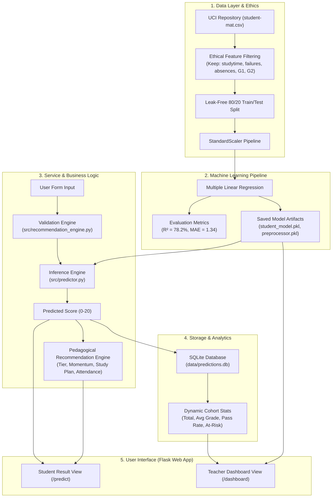

# Student Performance Predictor & Personalized Advisory System

A beginner-friendly, production-grade Machine Learning and Web Application designed to predict students' final examination scores based strictly on academic performance data and provide actionable, personalized improvement recommendations.

Built with **Python, Scikit-learn, Flask, and SQLite**, following ethical AI guidelines and leak-free machine learning practices.

---

## 1. Problem Statement
Academic failure and late course dropouts often occur because students, teachers, and parents lack early warning indicators. Traditional report cards only show past performance without forecasting final outcomes or diagnosing *why* a student is struggling. 

Furthermore, many predictive tools use sensitive personal or demographic characteristics (such as family background, gender, or home address), introducing algorithmic bias into educational evaluations.

---

## 2. Project Objectives
1. **Accurate Grade Forecasting:** Predict a student's final examination grade ($G_3$, on a $0\text{--}20$ scale) using academic and study-behavioral indicators.
2. **Ethical Machine Learning:** Ensure zero demographic bias by evaluating students solely on academic factors (study time, past failures, attendance, and continuous assessment grades).
3. **Actionable Improvement Plans:** Generate personalized, realistic advice across four educational dimensions (performance tier, grade momentum, study habit development, and attendance recovery).
4. **Interactive Dual-Portal Web Experience:** Deliver a student prediction simulator and an educator cohort analytics dashboard with Pinterest-inspired pastel aesthetics.

---

## 3. Main Features

- 🌸 **Student Simulator Portal (`/`):** Enter academic metrics with instant quick-test presets (**"Try High Achiever"** and **"Try At-Risk Student"**).
- 🏆 **Multi-Dimensional Advisory Engine:** Evaluates performance tier (Distinction, Merit, Pass, At-Risk), grade momentum ($G_1 \to G_2$), realistic study hour adjustments, and attendance support.
- 📊 **Teacher Cohort Analytics Dashboard (`/dashboard`):** Real-time cohort metrics dynamically calculated from actual student evaluation records (Class Average, Pass Rate %, At-Risk Count).
- 🔍 **Filterable Student Records Table:** Working client-side filters for All, Distinction, Merit, Pass, and At-Risk students.
- 📈 **Empirical Visual Analytics Gallery:** High-resolution diagnostic charts from the UCI dataset and model training.
- 🔒 **Privacy-First Persistence:** SQLite database stores prediction records without collecting student names or personal identifiers.

---

## 4. Technologies Used

| Technology | Purpose |
| :--- | :--- |
| **Python (3.10+)** | Core programming language |
| **Pandas & NumPy** | Data manipulation, cleaning, and numeric calculations |
| **Scikit-learn** | Machine learning pipeline, feature scaling, Linear Regression, and evaluation |
| **Flask** | Lightweight Python web framework and backend routing |
| **SQLite3** | Embedded lightweight relational database for prediction records |
| **Matplotlib & Seaborn** | Exploratory Data Analysis (EDA) and model diagnostic visualizations |
| **HTML5 & CSS3** | Pinterest-inspired responsive pastel UI (rounded cards, soft shadows) |
| **JavaScript (Vanilla)** | Dynamic form population and interactive table filtering |

---

## 5. Dataset Source & Description

- **Source:** [UCI Machine Learning Repository: Student Performance Dataset](https://archive.ics.uci.edu/dataset/320/student+performance)
- **Original Authors:** Paulo Cortez and Alice Silva (University of Minho, Portugal, 2008).
- **Target Variable ($y$):** `G3` — Final examination grade (Numeric: $0\text{--}20$ scale; passing threshold is $10/20$).

### Selected Academic Features (Input Matrix $X$):

| Column Name | Type | Range / Categories | Description |
| :--- | :---: | :---: | :--- |
| `studytime` | Ordinal | $1 - 4$ | Weekly study hours ($1: <2\text{h}$, $2: 2\text{--}5\text{h}$, $3: 5\text{--}10\text{h}$, $4: >10\text{h}$) |
| `failures` | Integer | $0 - 4$ | Number of past class failures ($0$ if none, up to $4$) |
| `absences` | Integer | $0 - 75$ | Total number of school absences during the academic term |
| `G1` | Numeric | $0.0 - 20.0$ | First period grade / continuous assignment score |
| `G2` | Numeric | $0.0 - 20.0$ | Second period midterm examination grade |

> [!NOTE]
> **Ethical AI Guarantee:** In accordance with AI fairness standards, 27 sensitive demographic and personal attributes (`sex`, `age`, `address`, `famsize`, `Pstatus`, `Mjob`, `Fjob`, `guardian`, `romantic`, etc.) were **permanently excluded** from training.

---

## 6. Project Folder Structure

```text
Student Performance Predictor/
├── data/
│   ├── raw/                          # Raw UCI dataset (student-mat.csv)
│   ├── processed/                    # Cleaned dataset, train/test split CSVs
│   └── predictions.db                # SQLite database for student records
├── docs/
│   └── dataset_documentation.md      # Provenance, citation, and data dictionary
├── models/
│   ├── student_model.pkl             # Trained Scikit-learn Linear Regression model
│   ├── preprocessor_pipeline.pkl     # Fitted StandardScaler preprocessing pipeline
│   └── model_metrics.json            # MAE, MSE, RMSE, R2, and coefficients
├── notebooks_or_scripts/
│   └── (optional exploratory scratchpad)
├── scripts/
│   ├── 01_download_data.py           # Automated dataset fetcher and ethical filter
│   ├── 02_eda_and_preprocessing.py   # Visualizations and 80/20 leak-free split
│   ├── 03_train_model.py             # Model training, evaluation, and serialization
│   ├── 04_test_recommendations.py    # Test runner for recommendation engine
│   ├── 05_test_flask_app.py          # Automated HTTP test suite for Flask app
│   └── 06_test_dashboard.py          # Automated test suite for teacher dashboard
├── screenshots/
│   └── README.md                     # Screenshot checklist for presentations
├── src/
│   ├── __init__.py
│   ├── database.py                   # SQLite persistence and dynamic stats engine
│   ├── predictor.py                  # Clean inference wrapper
│   └── recommendation_engine.py      # Rule-based pedagogical advisory logic
├── static/
│   ├── css/
│   │   └── style.css                 # Pinterest-inspired pastel stylesheet
│   ├── js/
│   │   └── teacher_dashboard.js      # Dynamic tier filter script
│   └── images/                       # Generated diagnostic charts (.png)
├── templates/
│   ├── base.html                     # Global HTML layout
│   ├── index.html                    # Student input form with quick presets
│   ├── result.html                   # Prediction result card and action plan
│   └── dashboard.html                # Teacher cohort analytics dashboard
├── app.py                            # Flask application entry point
├── requirements.txt                  # Python dependencies
├── test_pipeline.py                  # End-to-end unified 10-point test runner
└── README.md                         # Project documentation
```

---

## 7. System Architecture Diagram



---

## 8. Machine Learning Workflow Explained

1. **Ingestion & Ethical Selection:** Raw records ($N=395$) are checked for nulls and stripped of 27 demographic columns.
2. **Leak-Free Splitting:** The data is split into **$80\%$ training ($316$ students)** and **$20\%$ testing ($79$ students)** using a deterministic seed (`random_state=42`). Target $G_3$ is strictly isolated.
3. **Standardization:** `StandardScaler` calculates mean and variance **only** from the training set ($X_{\text{train}}$) and transforms both $X_{\text{train}}$ and $X_{\text{test}}$ without refitting.
4. **Fitting:** Ordinary Least Squares Linear Regression solves for coefficients that minimize the sum of squared residuals.
5. **Evaluation:** Unseen test students are passed through the model to calculate independent performance metrics.
6. **Serialization:** Model weights and scaling parameters are persisted using `joblib`.

---

## 9. Linear Regression Formula & Parameters

Multiple Linear Regression models the final exam mark as a linear combination of academic predictors:

$$\hat{y} = \beta_0 + \beta_1 \cdot Z(\text{studytime}) + \beta_2 \cdot Z(\text{failures}) + \beta_3 \cdot Z(\text{absences}) + \beta_4 \cdot Z(G_1) + \beta_5 \cdot Z(G_2)$$

*(where $Z(X)$ denotes standard score standardization)*

### Fitted Model Coefficients:
* **Baseline Intercept ($\beta_0$):** $10.33$ marks (the expected average score when features are at class mean).
* **$G_2$ (Term 2 Exam) [$\beta = +3.67$]:** Strongest positive driver. Midterm mastery is the single best predictor of final exam success.
* **$G_1$ (Term 1 Exam) [$\beta = +0.46$]:** Positive foundation. Early coursework builds cumulative exam readiness.
* **Past Class Failures [$\beta = -0.33$]:** Negative impact. Historical difficulty creates academic friction.
* **Absences [$\beta = +0.33$]:** Statistical artifact from raw distribution (e.g. students with zero absences dropping out unexpectedly); educational advisory logic explicitly enforces attendance recovery.
* **Study Time [$\beta = -0.06$]:** Collinear mediator ($G_1$ and $G_2$ already capture the benefits of studying).

---

## 10. Evaluation Metrics Explained

| Metric | Model Score | Meaning in Plain English |
| :--- | :---: | :--- |
| **MAE (Mean Absolute Error)** | **$1.34$ marks** | On average, predictions deviate by only **$1.34$ marks** out of 20. |
| **MSE (Mean Squared Error)** | **$4.47$** | The average squared error, which heavily penalizes large mistakes. |
| **RMSE (Root Mean Squared Error)** | **$2.11$ marks** | The standard deviation of errors, measured directly in marks. |
| **$R^2$ Score (Coefficient of Determination)** | **$0.7822$ ($78.2\%$)** | **$78.2\%$ of variance** in final scores is directly explained by the model. |

---

## 11. Personalized Recommendation Engine

The recommendation engine in [`src/recommendation_engine.py`](file:///c:/Users/Ethnotech/Desktop/Student%20Performance%20Predictor/src/recommendation_engine.py) evaluates 4 pedagogical dimensions:

1. **Performance Tier:**
   - **Distinction ($\ge 16.0$):** Outstanding academic standing; top honors.
   - **Merit ($14.0\text{--}15.9$):** Strong performance with high potential.
   - **Pass ($10.0\text{--}13.9$):** Satisfactory; meets passing standards.
   - **At-Risk ($< 10.0$):** Below passing threshold; triggers immediate academic intervention.
2. **Grade Momentum ($G_2 - G_1$):**
   - **Improving ($> +1.0$):** Positive trajectory; reinforces current study habits.
   - **Plateaued ($\pm 1.0$):** Stable performance; suggests active revision strategies.
   - **Declining ($< -1.0$):** Negative drop; recommends immediate post-mortem of Term 2 topics.
3. **Study Time Advice:**
   - Identifies study deficit without recommending unrealistic 20-hour cram schedules.
   - Recommends incremental targets (e.g., adding 30–45 minutes on 3 weekdays).
4. **Attendance Health:**
   - Flags high absences ($\ge 15$) and provides catch-up guidance, teacher coordination, and peer note-sharing.

---

## 12. SQLite Database & Cohort Analytics

The SQLite database (`data/predictions.db`) stores:
- `id` (Auto-incrementing record ID)
- `prediction_date` (Timestamp)
- `studytime`, `failures`, `absences`, `g1`, `g2`
- `predicted_score` (Bounded $0\text{--}20$)
- `performance_tier` and `grade_momentum`

**Teacher Dashboard Statistics Calculation:**
- $\text{Total Students} = \text{COUNT}(*)$
- $\text{Average Grade} = \text{AVG}(\text{predicted\_score})$
- $\text{Pass Rate} = \frac{\text{Count}(\text{score} \ge 10)}{\text{Total}} \times 100\%$
- $\text{At-Risk Students} = \text{Count}(\text{score} < 10)$

---

## 13. Installation & Setup Instructions (Windows)

### Prerequisites
- Python 3.10, 3.11, or 3.12 installed.
- PowerShell or Windows Command Prompt.

### Step 1: Open Terminal in Project Directory
```powershell
cd "c:\Users\Ethnotech\Desktop\Student Performance Predictor"
```

### Step 2: (Optional but Recommended) Create a Virtual Environment
```powershell
py -m venv venv
.\venv\Scripts\Activate.ps1
```

### Step 3: Install Required Dependencies
```powershell
pip install -r requirements.txt
```

---

## 14. How to Run the Web Application

To launch the Flask web application:

```powershell
py app.py
```
*(Or `python app.py`)*

### Accessing the Web Application:
* **Student Score Predictor Form:** Open your browser and navigate to:
  ```
  http://127.0.0.1:5000/
  ```
* **Teacher Analytics Dashboard:** Open:
  ```
  http://127.0.0.1:5000/dashboard
  ```

---

## 15. Testing Instructions

To run the unified 10-point verification test suite:

```powershell
py test_pipeline.py
```

### What `test_pipeline.py` Verifies:
1. Datasets exist, load cleanly, and match expected shapes ($395 \times 6$).
2. Preprocessor pipeline standardizes features.
3. Machine learning model loads with $R^2 \ge 78\%$.
4. Prediction outputs valid scores strictly between $0$ and $20$.
5. Recommendation engine generates correct tiers and plans.
6. Validation engine rejects bad inputs.
7. SQLite database persists prediction records.
8. Dashboard statistics calculate dynamically.
9. Flask routes (`/`, `/predict`, `/dashboard`) return HTTP 200.
10. All 5 visual analytics charts load successfully.

---

## 16. Limitations & Future Improvements

### Limitations:
- **Sample Size:** The dataset contains 395 secondary school Mathematics students. Expanding to larger multi-school cohorts would improve generalization.
- **Linearity Assumption:** Linear Regression assumes linear relationships between features and grades. Non-linear effects (such as high absence tipping points) are currently mediated by our rule-based engine.

### Future Improvements:
- **Ensemble Algorithms:** Benchmark Random Forest and Gradient Boosting (XGBoost) against Linear Regression.
- **Export Reports:** Add one-click PDF generation for student action plans.
- **Multi-Subject Support:** Extend models to science, languages, and humanities courses.

---

## 17. License & Academic Attribution
- Dataset provided by Paulo Cortez and Alice Silva under the Creative Commons Attribution 4.0 International (CC BY 4.0) License.
- Developed as an educational AI demonstration project.
